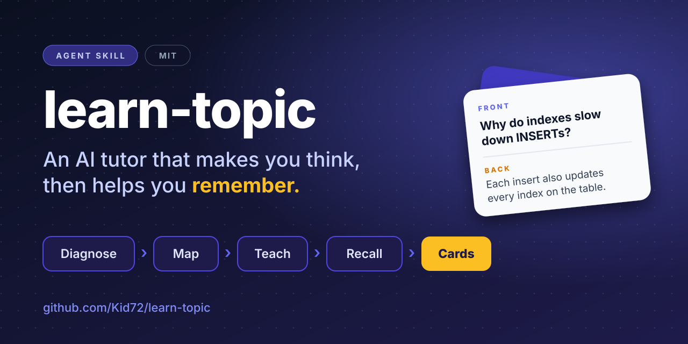
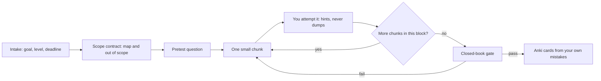

<p align="center">
  
</p>

<p align="center">
  <a href="LICENSE"></a>
  <a href="https://github.com/Kid72/learn-topic/releases"></a>
  <a href="https://agentskills.io"></a>
  
</p>

<h2 align="center">Stop reading answers. Start learning.</h2>

<p align="center">
An Agent Skill that turns your AI assistant into a patient tutor.<br>
It explains in small steps, makes you try first, checks you with a closed-book test,<br>
and ends with flashcards built from <em>your own</em> mistakes.
</p>

---

## Try it in 10 seconds

Install the skill (see [Install](#install)), open a new chat, and type:

```text
Teach me how database indexes work. I have a backend interview in two weeks.
```

Any topic works: a framework, a protocol, an exam syllabus, a certification, a chapter you are stuck on. Write in your own language and the tutor answers in it.

## Why it feels different

Asking an AI to "explain X" gives you a wall of text and a pleasant feeling of understanding. `learn-topic` is designed around what actually makes knowledge stick.

| A typical chat | With `learn-topic` |
| :--- | :--- |
| One long explanation of everything | One small chunk at a time, 120 words at most |
| You read, nod, and move on | You guess first, answer, and get hints instead of solutions |
| "ok" counts as understanding | A closed-book check decides when you move on |
| Difficulty jumps at random | A scope contract is agreed up front, and depth only grows when you ask |
| Flashcards that summarize the answer | Cards from your own slips, one idea each, answer in about 12 words |
| Stuck? You get a lecture | Stuck? A ladder of hints, one rung per turn |
| In a hurry? Argue with the bot | Say "just tell me": you get the answer, then a twin task to lock it in |

## See it in action

> *An illustrative session. The full version is in [examples/sample-session.md](examples/sample-session.md).*

**You:** Teach me how database indexes work. I have a backend interview in two weeks.

**Tutor:** Quick setup so I aim right: 1. Which database do you use day to day? 2. Have you added or dropped an index before, and what happened? 3. Do you want interview-level answers or deep tuning?

**You:** Postgres. Added a few, never measured anything. Interview level.

**Tutor:** Plan: 1. What an index does. 2. The write cost. 3. Composite indexes. 4. Selectivity and EXPLAIN. Out of scope: B-tree internals, vacuum tuning. Go with this, or adjust?

**You:** Go.

**Tutor:** Before I explain anything: a table has 10 million rows and you filter by `email` with no index. Roughly, what does the database have to do? A wrong guess is fine.

**You:** Check every row?

**Tutor:** Yes, a full scan. An index is a sorted lookup structure, so the database jumps to matching rows instead of reading all of them. Now you: you add an index on `email`. Name one cost you now pay on every INSERT.

**You:** No idea.

**Tutor:** Hint: when a new row arrives, where else does its email value have to go?

**You:** Into the index too?

**Tutor:** Exactly. Every write updates the table and each index on it. Next: ...

Every tutor turn ends with exactly one question or task. That is the whole trick.

## Install

> Skills are plain-text instructions your agent follows. As with any third-party skill or plugin, read `skills/learn-topic/` before installing.

### Claude Code (plugin marketplace)

```text
/plugin marketplace add Kid72/learn-topic
/plugin install learn-topic@kid72-skills
```

### Any agent that supports skills, via `npx`

Requires Node.js 22.20 or newer.

```bash
npx skills add Kid72/learn-topic --skill learn-topic
```

Add `-g` to install globally, or `-a codex` / `-a claude-code` to pick an agent.

### Claude.ai and Claude Desktop

1. Download `learn-topic.zip` from the [latest release](https://github.com/Kid72/learn-topic/releases/latest).
2. Open **Customize → Skills**, upload the zip, and switch the skill on.

Use the zip from the release page. GitHub's "Download ZIP" button wraps the folder in a different name, which the upload does not accept.

### Gemini CLI

```bash
gemini skills install https://github.com/Kid72/learn-topic.git --path skills/learn-topic
```

### Manual copy

```bash
git clone https://github.com/Kid72/learn-topic.git
cp -r learn-topic/skills/learn-topic ~/.claude/skills/      # personal
cp -r learn-topic/skills/learn-topic .claude/skills/        # one project
```

Other agents read `~/.agents/skills/` or `.agents/skills/`.

## How it works



The rules the tutor holds itself to:

- **Attempt first.** You answer or guess before any hint. A wrong guess counts.
- **Hint ladder.** Narrowing question, then principle, then a partial worked step, then the full answer. One rung per turn.
- **Short turns.** At most 120 words and exactly one question or task.
- **No escalation.** A correct answer is followed by the next map item, not by a harder detour.
- **Taught before tested.** Tasks only use concepts already covered and state every given.
- **"ok" is not mastery.** The tutor asks for a quick check instead of moving on.
- **Cards only after the gate.** Only items you actually worked through.

The skill loads in layers, so it stays light: `SKILL.md` carries the workflow, and three reference files are opened only when needed.

## Flashcards worth reviewing

After you pass a block, the tutor offers cards. They come from your slips, hesitations, and the insights you reached yourself, not from a summary of the lesson.

```csv
front,back,notes,tags
"Why does adding an index slow down INSERTs?","Each insert must also update every index on the table.","Learner's first answer was 'no idea'; reached it from one hint.","databases::indexes writes"
"Index on (a, b): is a filter on b alone served well?","Usually not: the leading column a drives the lookup.","","databases::indexes composite"
```

Card rules: one idea per card, answer recallable in under 10 seconds, no lists, no formulas with three or more factors, at most six cards per block. More in [`anki-cards.md`](skills/learn-topic/references/anki-cards.md) and a full file in [`examples/sample-cards.csv`](examples/sample-cards.csv).

<details>
<summary><strong>Import into Anki (2 minutes, once)</strong></summary>

1. **Tools → Manage Note Types → Add → Add: Basic**, name it `Basic + Notes`, then **Fields → Add** a field called `Notes`.
2. **Cards → Back Template**: add `{{Notes}}` under `{{Back}}`.
3. **File → Import**, choose the CSV, set the note type to `Basic + Notes`, and map columns 1 to 4 to Front, Back, Notes, Tags.
4. If the header row `front,back,notes,tags` shows up as a card, delete that one card.

Any app that imports CSV with these four columns works the same way.

</details>

## Built on research

Each part of the workflow maps to a technique with published evidence.

| Idea | Where it shows up | Source | Evidence |
| :--- | :--- | :--- | :---: |
| Practice testing | Pretest per block, closed-book gate | [Dunlosky et al. 2013](https://www.psychologicalscience.org/news/releases/which-study-strategies-make-the-grade.html) rated it a top-utility technique | Strong |
| Spaced repetition | Cards for Anki, review schedule | [Cepeda et al. 2008](https://pubmed.ncbi.nlm.nih.gov/19076480/) on optimal spacing gaps | Strong |
| Pretesting | Guess before the explanation | [Richland, Kornell, Kao 2009](https://learninglab.uchicago.edu/Pre-Testing_files/RichlandKornellKao.pdf) | Moderate |
| Attempt first, hints over answers | Hint ladder, answer switch | [Bastani et al., PNAS 2025](https://knowledge.wharton.upenn.edu/article/without-guardrails-generative-ai-can-harm-education): tutor-style hints avoided the exam drop seen with plain GPT | Moderate |
| Guided AI tutoring | Scaffolded steps, one chunk at a time | [Kestin et al., Scientific Reports 2025](https://pmc.ncbi.nlm.nih.gov/articles/PMC12179260/): a carefully prompted tutor beat in-class active learning | Moderate |
| No "learning styles" | The tutor adapts to your answers, not a style quiz | [Pashler et al. 2008](https://pubmed.ncbi.nlm.nih.gov/26162104/) | Moderate |
| Atomic flashcards | One idea per card, short answers | [Wozniak, 20 rules of formulating knowledge](https://www.supermemo.com/en/blog/twenty-rules-of-formulating-knowledge) | Practitioner rules |

## FAQ

<details>
<summary><strong>Can I skip the questions and just get the answer?</strong></summary>

Yes. Say "just tell me". You get the answer in 120 words or fewer, followed by a twin task with different numbers so it sticks.

</details>

<details>
<summary><strong>Does it work in my language?</strong></summary>

Yes. The tutor replies in the language of your latest message and switches when you do. Cards are written in your language, and established technical terms stay in their original form.

</details>

<details>
<summary><strong>Do I need Anki?</strong></summary>

No. Cards are an optional last step, offered only after you pass a block. Decline and you simply get a short wrap-up with what is solid and what is shaky.

</details>

<details>
<summary><strong>Which topics suit it?</strong></summary>

Anything with concepts you can be asked about: software and system design, databases, networking, math, science, languages, certifications, exam syllabi, or a chapter of a book.

</details>

<details>
<summary><strong>Does it run code or send data anywhere?</strong></summary>

No. The skill is Markdown instructions only: no scripts, no network calls.

</details>

<details>
<summary><strong>How do I resume a topic later?</strong></summary>

At wrap-up the tutor gives you a one-line restart note. Paste it into a new chat and the tutor skips intake and opens with a short closed-book warm-up on your shaky items.

</details>

## What's inside

```text
learn-topic/
├── skills/learn-topic/
│   ├── SKILL.md                  workflow and hard rules
│   └── references/
│       ├── session-flow.md       intake, scope contract, blocks, gate, wrap-up
│       ├── teaching-moves.md     hint ladder, error handling, practice design
│       └── anki-cards.md         card checklist and CSV format
├── examples/                     sample session and sample cards
├── .claude-plugin/               plugin marketplace manifests
└── assets/                       banner
```

## Contributing

Seen the tutor go off the rails, or have an idea for a better teaching move? Open an [issue](https://github.com/Kid72/learn-topic/issues/new/choose) with the transcript, or send a pull request. See [CONTRIBUTING.md](CONTRIBUTING.md).

If it helps you learn something, a star helps other people find it.

## License

[MIT](LICENSE) © Kid72
