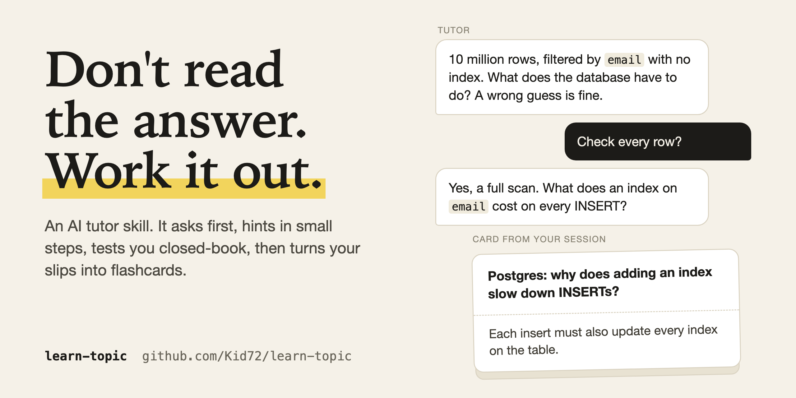

<p align="center">
  
</p>

<p align="center">
An Agent Skill that turns your AI assistant into a patient tutor. It explains in small steps, makes you try first, checks you with a closed-book test, and ends with flashcards built from your own mistakes and a one-page study note for Notion.
</p>

<p align="center">
  <a href="LICENSE"></a>
  <a href="https://github.com/Kid72/learn-topic/releases"></a>
  <a href="https://agentskills.io"></a>
  
</p>

## Try it

Install the skill (below), start a new chat, and type:

```text
Teach me how database indexes work. I have a backend interview in two weeks.
```

Any topic works: a framework, a protocol, a certification, a chapter you are stuck on. Write in your language and the tutor replies in it.

## A taste of a session

> **Tutor:** Before I explain anything: a table has 10 million rows and you filter by `email` with no index. Roughly, what does the database have to do? A wrong guess is fine.
>
> **You:** Check every row?
>
> **Tutor:** Yes, a full scan. An index is a sorted lookup structure. Now you: you add an index on `email`. Name one cost you now pay on every INSERT.
>
> **You:** No idea.
>
> **Tutor:** Hint: when a new row arrives, where else does its email value have to go?

The full session is in [examples/sample-session.md](examples/sample-session.md).

## Install

**Claude Code**

```text
/plugin marketplace add Kid72/learn-topic
/plugin install learn-topic@kid72-skills
```

**Any agent with skills support** (needs Node.js 22.20 or newer)

```bash
npx skills add Kid72/learn-topic --skill learn-topic
```

<details>
<summary>Claude.ai, Gemini app, Antigravity CLI (agy), manual copy</summary>

- **Claude.ai and Claude Desktop:** download `learn-topic.zip` from the [latest release](https://github.com/Kid72/learn-topic/releases/latest), open **Customize → Skills**, upload it, and switch it on.
- **Gemini app:** download `learn-topic-gemini.zip` from the latest release, open **Customize → Skills → Create → Upload**, choose the zip, then **Create**.
- **Antigravity CLI (`agy`):** copy the folder with `cp -r skills/learn-topic ~/.gemini/config/skills/`, then run `/skills reload`. Or use `npx skills add Kid72/learn-topic --skill learn-topic -a antigravity-cli`.
- **Manual, Claude Code:** `cp -r skills/learn-topic ~/.claude/skills/`

</details>

A skill is plain-text instructions your agent follows, so read `skills/learn-topic/` before installing, as with any third-party skill. Every option in detail: [docs/INSTALL.md](docs/INSTALL.md).

## How it works

The method combines techniques with published evidence (practice testing, pretesting, spaced review, hints over answers) and a few design choices that keep turns short. Sources and what each one found: [docs/research.md](docs/research.md).

- **Quick intake, agreed scope.** The tutor asks about your goal, level, and deadline, then shows a map with what is out of scope. You confirm before anything is taught.
- **You try first.** A guess comes before any hint, and hints come as a ladder, one rung per turn. Say "just tell me" at any point and you get the answer plus a twin task.
- **Short turns.** At most 120 words and exactly one question or task.
- **A closed-book check** decides when you move on. "ok" is not mastery.
- **Cards and a study note at the end.** Flashcards for Anki, and a short Markdown note for Notion that covers the whole topic.


## Flashcards worth reviewing

After you pass a block, the tutor offers cards. They come from your slips and hesitations, one idea each, with answers short enough to recall in seconds.

```csv
front,back,notes,tags
"Postgres: why does adding an index slow down INSERTs?","Each insert must also update every index on the table.","Learner's first answer was 'no idea'; reached it from one hint.","databases::indexes writes"
"Postgres, index on (a, b): which filter column can use it alone?","Only a, the leading column; a filter on b alone usually cannot.","","databases::indexes composite"
```

A full file is in [examples/sample-cards.csv](examples/sample-cards.csv). Import steps: [docs/anki-import.md](docs/anki-import.md).

## A study note for Notion

Ask for it at the wrap-up, or any time: "make a study note". You get one Markdown file, about one to two screens, that covers the whole topic: an overview, 5 to 8 key ideas, the spots that were shaky in your session, self-test questions with the answers on the next line, an empty "Your turn" section for your own words, and a review checklist. Reviews are recall attempts, not rereading.

Import it in Notion via Settings, Import, Text & Markdown. See a complete example in [examples/sample-notes.md](examples/sample-notes.md) and details in [docs/notion-import.md](docs/notion-import.md).

## FAQ

<details>
<summary><strong>Do I need Anki?</strong></summary>

No. Cards are an optional last step, offered only after you pass a block. Decline and you get a short wrap-up of what is solid and what is shaky.

</details>

<details>
<summary><strong>Do I need Notion?</strong></summary>

No. The note is a plain Markdown file, so any Markdown editor opens it. It is written to import cleanly into Notion.

</details>

<details>
<summary><strong>Does it work in my language?</strong></summary>

Yes. The tutor replies in the language of your latest message and switches when you do. Cards use your language, and established technical terms stay as they are.

</details>

<details>
<summary><strong>Does it run code or send data anywhere?</strong></summary>

The skill is Markdown instructions with no scripts, and it sends nothing anywhere itself. Everything happens inside your agent: the chat, and the CSV file it writes. If you ask for a diagram or an interactive visual, the agent makes it with its own tools, as in any chat.

</details>

## More

- [Install options](docs/INSTALL.md)
- [Importing cards into Anki](docs/anki-import.md)
- [Importing the study note into Notion](docs/notion-import.md)
- [The research behind the method](docs/research.md)

Found the tutor misbehaving, or have an idea? Open an [issue](https://github.com/Kid72/learn-topic/issues/new/choose) or read [CONTRIBUTING.md](CONTRIBUTING.md).

## License

[MIT](LICENSE) © Kid72
